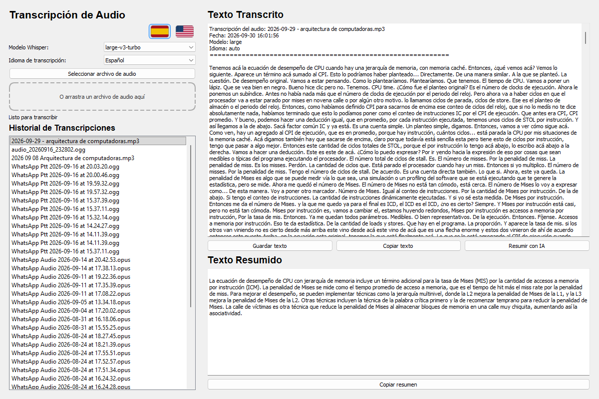

# Whispea

¿Cansado de recibir audios en clase y no poder escucharlos? ¿De tener grabaciones de clases de 2 horas y necesitar transcribirlas para sacar notas? ¿Siempre renegando porque las alternativas web no permiten cosas largas o te piden pagar?

Yo también. Por eso armé **Whispea**: una herramienta de escritorio que transcribe y resume audio de manera **100% local**, corriendo modelos en tu propia máquina — sin subir nada a ningún server, sin APIs pagas, sin límites de duración.



## Características

- **Transcripción local con faster-whisper** — arrastrá o seleccioná un audio y obtené el texto
- **BatchedInferencePipeline** — transcripción ~2x más rápida en CPU con `batch_size=8`
- **Resumen con IA local con Ollama** — un clic y un modelo local ([Ollama](https://ollama.com)) te resume la transcripción en un párrafo
- **Resumen en streaming** — el resumen aparece a medida que el modelo lo genera
- **Historial** — cada transcripción y su resumen quedan guardados y se pueden recargar con un clic
- **Modelo precargado** — el modelo Whisper se carga al iniciar y queda en caché para la próxima transcripción
- **Multiidioma** — interfaz en español e inglés (selector con banderas), transcripción en 29 idiomas + detección automática
- **Preferencias persistentes** — modelo Whisper, idioma de transcripción e idioma de UI se guardan en `prefs.json`
- **Drag & drop** — arrastrá el archivo a la ventana y listo
- **Sin límites de duración** — tu máquina, tus reglas: audios de 2 horas incluidos

## Requisitos

- Python 3.10+
- [FFmpeg](https://ffmpeg.org) en el PATH (recomendado: se usa para pre-convertir el audio a 16kHz mono antes de transcribir; sin él, faster-whisper decodifica directamente con PyAV)
- [Ollama](https://ollama.com) instalado + un modelo para los resúmenes (ver Instalación)

## Instalación

```bash
git clone https://github.com/Sarapa17/Whispea.git
cd Whispea

# Crear y activar venv
python -m venv venv            # Windows
# python3 -m venv venv         # Linux/macOS

.\venv\Scripts\Activate.ps1    # Windows PowerShell
# source venv/bin/activate     # Linux/macOS

# Dependencias
pip install -r requirements.txt

# Modelo para los resúmenes (~2GB)
ollama pull qwen2.5:3b
```

El primer arranque descarga el modelo Whisper seleccionado (`large-v3-turbo` por defecto), así que puede tardar varios minutos.

### Preferencias

Copiá el ejemplo de preferencias y ajustalo a tu gusto:

```bash
cp prefs.example.json prefs.json
```

`prefs.json` guarda:
- `model_size`: `tiny` | `base` | `small` | `medium` | `large` | `large-v3-turbo` (default: `large-v3-turbo`)
- `transcription_language`: código de idioma o `auto` (default: `es`)
- `ui_language`: `es` | `en`

Si no creás el archivo, la app usa los valores por defecto y lo genera automáticamente al cambiar el idioma de la interfaz o iniciar una transcripción. El archivo está en `.gitignore` para que sea local por usuario.

## Uso

```bash
python main.py
```

1. Seleccioná o arrastrá un archivo de audio (mp3, wav, ogg, flac, m4a, wma, aac, opus)
2. Esperá a que termine la transcripción
3. Clic en **"Resumir con IA"** para generar el resumen
4. **"Copiar resumen"** / **"Copiar texto"** / **"Guardar texto"** para lo que necesites

Al abrir la app se precarga el modelo Whisper elegido. Si Ollama no está corriendo, la app intenta iniciarlo automáticamente.

### Historial y archivos generados

Cada transcripción crea tres archivos en `history/`:

- `<timestamp>.<ext>` → copia del audio original
- `<timestamp>.txt` → texto transcripto y, si se generó, el resumen bajo el encabezado `RESUMEN (IA):`
- `<timestamp>.json` → metadatos (nombre original, fecha, modelo, idioma y preview del texto)

La carpeta `history/` está en `.gitignore` y queda solo en tu máquina.

## Cómo funciona

- **Transcripción**: [faster-whisper](https://github.com/faster-whisper/faster-whisper) corre 100% local en CPU. Antes de transcribir, el audio se pre-convierte a WAV 16kHz mono con FFmpeg (el formato nativo de Whisper); si FFmpeg no está disponible, se usa el archivo original y faster-whisper lo decodifica directamente con PyAV (mp3, ogg, flac, m4a, wma, aac, opus)
- **Modelo**: se precarga al iniciar y se cachea por tamaño; al cambiar de modelo, se carga la primera vez que transcribís
- **Resumen**: la app le pega a un server local de [Ollama](https://ollama.com) (`http://localhost:11434`) con el modelo configurado y muestra la respuesta en streaming — el texto nunca sale de tu máquina
- **Ollama**: si el server no está corriendo, la app intenta levantarlo con `ollama serve`; si no está instalado, muestra un error claro
- **Historial**: todo queda en `history/`

## Estructura del proyecto

- `main.py` → ventana principal (`AudioTranscriberApp`) y punto de entrada
- `config.py` → configuración, preferencias (`prefs.json`) e internacionalización (`TRANSLATIONS`, `WHISPER_LANGUAGES`)
- `core.py` → hilos de trabajo (`TranscriptionThread`, `SummaryThread`, `ModelPreloadThread`)
- `translations.json` → textos de la interfaz en español e inglés
- `whisper_languages.json` → idiomas disponibles para transcribir
- `prefs.example.json` → plantilla de preferencias
- `requirements.txt` → dependencias de la app y de desarrollo
- `tests/` → tests de configuración e historial (`pytest`)
- `.githooks/pre-commit` → hook que ejecuta Ruff y los tests antes de cada commit

## Desarrollo

El proyecto usa [pytest](https://pytest.org) para los tests y [Ruff](https://docs.astral.sh/ruff/) para el linting. Ambas herramientas ya vienen incluidas en `requirements.txt`.

```bash
# Ejecutar los tests
pytest -q

# Revisar el estilo y errores estáticos
ruff check .

# Activar el hook de pre-commit (una sola vez)
git config core.hooksPath .githooks
```

El hook `.githooks/pre-commit` corre `ruff check .` y `pytest -q` antes de cada commit.

## Configuración

### Preferencias persistentes

Las preferencias de usuario se guardan en `prefs.json`:
- `model_size` → modelo Whisper a usar
- `transcription_language` → idioma de transcripción o `auto`
- `ui_language` → idioma de la interfaz `es`/`en`

Ejemplo: `prefs.example.json`

### Variables en `config.py`

| Constante | Default | Qué hace |
|---|---|---|
| `OLLAMA_MODEL` | `"qwen2.5:3b"` | El modelo de Ollama que resume (cambialo por `qwen2.5:7b` si querés más calidad) |
| `PROMPT_TEMPLATE` | `"Resumí el siguiente texto..."` | El prompt que se le envía al modelo |
| `MAX_SUMMARY_INPUT_CHARS` | `25000` | Límite de caracteres que se envían al modelo |
| `PREFS_PATH` | `prefs.json` en la raíz | Ruta del archivo de preferencias |

## Notas

- El modelo elegido (`qwen2.5:3b`, ~2GB) corre rápido en CPU (~15-25 tok/s en un Ryzen 7) y es de lo mejor en español para resúmenes
- Si Ollama no está corriendo, la app intenta iniciarlo y, si no está instalado o falla, te avisa con un mensaje claro (no crashea)
- Probado en Windows 11 y macOS; en Linux debería funcionar ajustando la activación del venv
